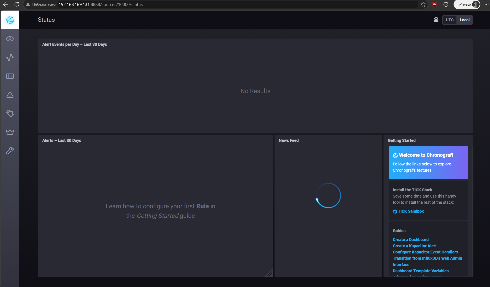
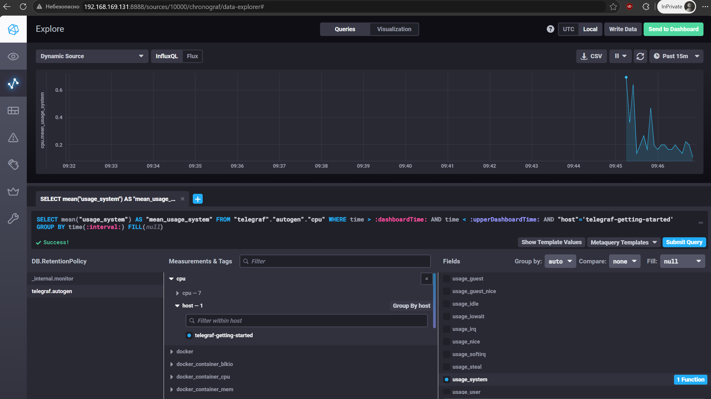
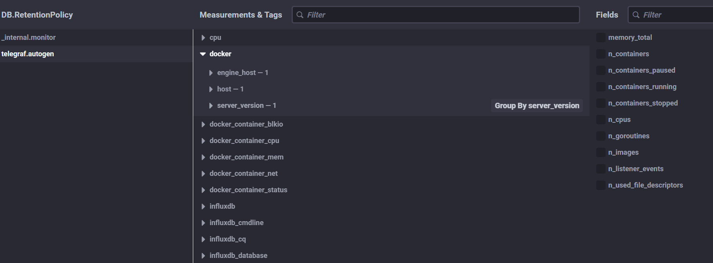

# Домашнее задание к занятию "13.Системы мониторинга"

## Обязательные задания

1. Вас пригласили настроить мониторинг на проект. На онбординге вам рассказали, что проект представляет из себя 
платформу для вычислений с выдачей текстовых отчетов, которые сохраняются на диск. Взаимодействие с платформой 
осуществляется по протоколу http. Также вам отметили, что вычисления загружают ЦПУ. Какой минимальный набор метрик вы
выведите в мониторинг и почему?

*Для мониторинга платформы необходимо отслеживать загрузку CPU, использование RAM, свободное место на диске и количество доступных inode. Также следует контролировать доступность HTTP-сервиса, время ответа и количество ошибок HTTP. Поскольку вычисления нагружают процессор, важно отслеживать Load Average и продолжительность выполнения задач. Эти метрики позволят своевременно обнаруживать перегрузки, нехватку ресурсов и проблемы с доступностью сервиса.*
#
2. Менеджер продукта посмотрев на ваши метрики сказал, что ему непонятно что такое RAM/inodes/CPUla. Также он сказал, 
что хочет понимать, насколько мы выполняем свои обязанности перед клиентами и какое качество обслуживания. Что вы 
можете ему предложить?

*Я бы предложил использовать метрики SLI, SLO и SLA, которые отражают качество обслуживания с точки зрения пользователей. Например, процент успешных HTTP-запросов, доступность сервиса и время формирования отчётов. Для наглядности можно создать отдельный дашборд с процентами и графиками выполнения целевых показателей. Это позволит менеджеру оценивать качество работы сервиса без необходимости разбираться в технических метриках оборудования.*
#
3. Вашей DevOps команде в этом году не выделили финансирование на построение системы сбора логов. Разработчики в свою 
очередь хотят видеть все ошибки, которые выдают их приложения. Какое решение вы можете предпринять в этой ситуации, 
чтобы разработчики получали ошибки приложения?

*Можно развернуть бесплатную систему централизованного сбора логов на базе Grafana Loki и Grafana. Для передачи логов приложений использовать Grafana Alloy, который будет собирать их и отправлять в Loki. Разработчики смогут просматривать ошибки через веб-интерфейс Grafana, фильтровать их по приложениям и времени возникновения. Решение не требует покупки лицензий, но потребует вычислительных ресурсов для хранения и обработки логов.*
#
4. Вы, как опытный SRE, сделали мониторинг, куда вывели отображения выполнения SLA=99% по http кодам ответов. 
Вычисляете этот параметр по следующей формуле: summ_2xx_requests/summ_all_requests. Данный параметр не поднимается выше 
70%, но при этом в вашей системе нет кодов ответа 5xx и 4xx. Где у вас ошибка?

*Ошибка заключается в том, что формула учитывает только HTTP-ответы с кодами 2xx, но общее количество запросов включает и другие коды. Если ошибок 4xx и 5xx нет, оставшиеся 30% могут приходиться на перенаправления 3xx. Такие ответы не обязательно означают сбой сервиса, но при текущем расчёте не считаются успешными. Необходимо проверить распределение HTTP-кодов и согласовать, какие ответы считаются успешными в рамках SLA.*
#
5. Опишите основные плюсы и минусы pull и push систем мониторинга.

*В модели Pull система мониторинга самостоятельно опрашивает источники метрик через заданные интервалы. Преимуществами являются централизованное управление сбором данных и возможность определять недоступность источников, а недостатками — необходимость сетевой доступности и сложность мониторинга кратковременных задач. В модели Push источники самостоятельно отправляют метрики на сервер, что удобно для динамической инфраструктуры и кратковременных процессов. Недостатками Push являются необходимость контролировать доставку метрик и сложность определения отказа источника без дополнительных механизмов.*
#
6. Какие из ниже перечисленных систем относятся к push модели, а какие к pull? А может есть гибридные?

    - Prometheus 
    - TICK
    - Zabbix
    - VictoriaMetrics
    - Nagios
#
*Prometheus преимущественно использует Pull-модель, самостоятельно опрашивая HTTP-эндпоинты с метриками. TICK-стек в основном работает по Push-модели, поскольку Telegraf отправляет собранные данные в InfluxDB. Zabbix является гибридной системой и поддерживает как пассивные проверки, так и активную отправку данных агентами. VictoriaMetrics поддерживает оба подхода: приём отправляемых метрик и опрос источников через vmagent. Nagios преимущественно использует Pull, но также поддерживает пассивные проверки с передачей результатов извне.*

7. Склонируйте себе [репозиторий](https://github.com/influxdata/sandbox/tree/master) и запустите TICK-стэк, 
используя технологии docker и docker-compose.

В виде решения на это упражнение приведите скриншот веб-интерфейса ПО chronograf (`http://localhost:8888`). 
<br>


P.S.: если при запуске некоторые контейнеры будут падать с ошибкой - проставьте им режим `Z`, например
`./data:/var/lib:Z`
#
8. Перейдите в веб-интерфейс Chronograf (http://localhost:8888) и откройте вкладку Data explorer.
        
    - Нажмите на кнопку Add a query
    - Изучите вывод интерфейса и выберите БД telegraf.autogen
    - В `measurments` выберите cpu->host->telegraf-getting-started, а в `fields` выберите usage_system. Внизу появится график утилизации cpu.
    - Вверху вы можете увидеть запрос, аналогичный SQL-синтаксису. Поэкспериментируйте с запросом, попробуйте изменить группировку и интервал наблюдений.

Для выполнения задания приведите скриншот с отображением метрик утилизации cpu из веб-интерфейса.
<br>

#
9. Изучите список [telegraf inputs](https://github.com/influxdata/telegraf/tree/master/plugins/inputs). 
Добавьте в конфигурацию telegraf следующий плагин - [docker](https://github.com/influxdata/telegraf/tree/master/plugins/inputs/docker):
```
[[inputs.docker]]
  endpoint = "unix:///var/run/docker.sock"
```

Дополнительно вам может потребоваться донастройка контейнера telegraf в `docker-compose.yml` дополнительного volume и 
режима privileged:
```
  telegraf:
    image: telegraf:1.4.0
    privileged: true
    volumes:
      - ./etc/telegraf.conf:/etc/telegraf/telegraf.conf:Z
      - /var/run/docker.sock:/var/run/docker.sock:Z
    links:
      - influxdb
    ports:
      - "8092:8092/udp"
      - "8094:8094"
      - "8125:8125/udp"
```

После настройке перезапустите telegraf, обновите веб интерфейс и приведите скриншотом список `measurments` в 
веб-интерфейсе базы telegraf.autogen . Там должны появиться метрики, связанные с docker.
<br>


Факультативно можете изучить какие метрики собирает telegraf после выполнения данного задания.

## Дополнительное задание (со звездочкой*) - необязательно к выполнению

1. Вы устроились на работу в стартап. На данный момент у вас нет возможности развернуть полноценную систему 
мониторинга, и вы решили самостоятельно написать простой python3-скрипт для сбора основных метрик сервера. Вы, как 
опытный системный-администратор, знаете, что системная информация сервера лежит в директории `/proc`. 
Также, вы знаете, что в системе Linux есть  планировщик задач cron, который может запускать задачи по расписанию.

Суммировав все, вы спроектировали приложение, которое:
- является python3 скриптом
- собирает метрики из папки `/proc`
- складывает метрики в файл 'YY-MM-DD-awesome-monitoring.log' в директорию /var/log 
(YY - год, MM - месяц, DD - день)
- каждый сбор метрик складывается в виде json-строки, в виде:
  + timestamp (временная метка, int, unixtimestamp)
  + metric_1 (метрика 1)
  + metric_2 (метрика 2)
  
     ...
     
  + metric_N (метрика N)
  
- сбор метрик происходит каждую 1 минуту по cron-расписанию

Для успешного выполнения задания нужно привести:

а) работающий код python3-скрипта,

б) конфигурацию cron-расписания,

в) пример верно сформированного 'YY-MM-DD-awesome-monitoring.log', имеющий не менее 5 записей,

P.S.: количество собираемых метрик должно быть не менее 4-х.
P.P.S.: по желанию можно себя не ограничивать только сбором метрик из `/proc`.

2. В веб-интерфейсе откройте вкладку `Dashboards`. Попробуйте создать свой dashboard с отображением:

    - утилизации ЦПУ
    - количества использованного RAM
    - утилизации пространства на дисках
    - количество поднятых контейнеров
    - аптайм
    - ...
    - фантазируйте)
    
    ---

### Как оформить ДЗ?

Выполненное домашнее задание пришлите ссылкой на .md-файл в вашем репозитории.

---
